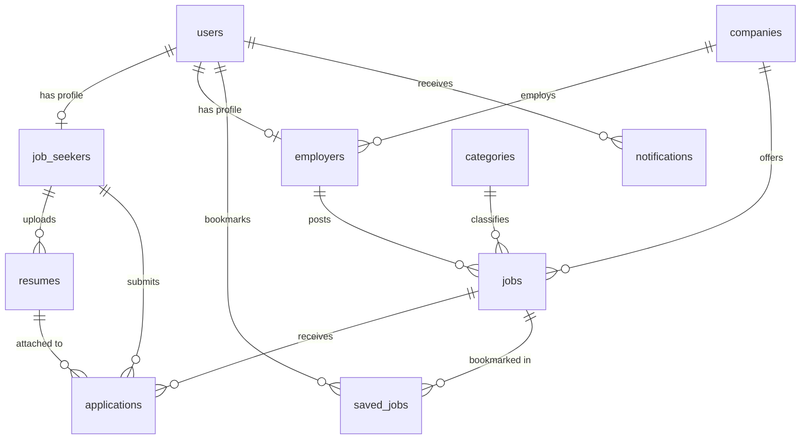

# JobConnect – Smart Job Portal 🚀
> Complete, Modern, Professional, and Fully Functional Job Portal Platform inspired by **Naukri.com**, **Indeed**, and **LinkedIn Jobs**.

[](https://www.python.org/)
[](https://flask.palletsprojects.com/)
[](https://www.mysql.com/)
[](https://getbootstrap.com/)
[](LICENSE)

---

## 📖 Table of Contents
1. [Project Overview](#-project-overview)
2. [Key Features by Role](#-key-features-by-role)
3. [Technology Stack](#-technology-stack)
4. [System Architecture & Database Schema](#-system-architecture--database-schema)
5. [UI Architecture & Screen Highlights](#-ui-architecture--screen-highlights)
6. [Folder Structure](#-folder-structure)
7. [Installation & Setup Guide](#-installation--setup-guide)
8. [Database Configuration (MySQL & SQLite)](#-database-configuration-mysql--sqlite)
9. [Pre-Seeded Demo Credentials](#-pre-seeded-demo-credentials)
10. [Running the Test Suite](#-running-the-test-suite)
11. [Contributing & License](#-contributing--license)

---

## 🌟 Project Overview
**JobConnect** is an enterprise-grade recruitment and career platform designed for India's technology ecosystem. It connects verified tech professionals (Data Scientists, Machine Learning Engineers, Python Backend Developers, Full-Stack Engineers, and Business Analysts) with fast-growing startups, Indian unicorns, and multinational GCCs.

The platform provides genuine database workflows, real-time application stage transitions, automated candidate-to-job skill matching, resume storage and retrieval, and responsive analytics dashboards powered by Chart.js.

---

## 🎯 Key Features by Role

### 👨‍💻 1. Job Seeker
- **Authentication & Security:** Secure registration and login with salted password hashing.
- **Rich Candidate Profile:** Manage personal info, professional headline, summary bio, location, contact, current & expected CTC, and links to GitHub, LinkedIn, and personal portfolio.
- **Academic & Career Timeline:** Add, view, and delete multiple education degrees, work experience records, and featured tech projects.
- **Skills Tagging:** Add comma-separated skill tags automatically scored against job openings.
- **PDF Resume Management:** Drag-and-drop or upload PDF resumes, set a primary resume, preview file sizes, and download resumes directly.
- **Multi-Faceted Job Search:** Live keyword search, city filter (Bengaluru, Hyderabad, Pune, Mumbai, Gurgaon, Noida, Remote), category filter, job type, work mode, experience level, and **interactive minimum CTC slider** (0 to 40+ LPA).
- **One-Click Application:** Apply with stored resumes or upload a custom resume, accompanied by a personalized pitch. Built-in duplicate application prevention.
- **Live Application Tracking:** Track real-time progress through 6 hiring stages: `Applied` ➔ `Under Review` ➔ `Shortlisted` ➔ `Interview Scheduled` ➔ `Offered` ➔ `Rejected` with direct recruiter feedback notes.
- **Job Bookmarking:** Instant AJAX save/bookmark toggle with heart icon and toast alerts.

### 🏢 2. Employer / Recruiter
- **Company Branding Profile:** Customize company overview, official website, team size, headquarters location, industry sector, and founding year.
- **Post Technical Vacancies:** Multi-attribute posting form covering job title, category, work mode, experience requirement, salary range in LPA, vacancies, deadline date, skills, detailed description, prerequisites, and company perks.
- **Manage Job Postings:** Centralized listing table with live status toggle (`Active` / `Closed`), applicant count badges, edit opening, and safe delete.
- **Candidate Applicants Hub:** Filter applicants by job opening and evaluation stage. View candidate profile summaries, matched skill badges, and cover pitches.
- **Resume Download:** Download applicant PDF resumes with 1 click.
- **Hiring Pipeline Decisions:** Update candidate stages (`Under Review`, `Shortlist`, `Interview`, `Offer`, `Reject`) with personalized feedback notes that instantly notify the candidate.

### 🛡️ 3. Administrator
- **Executive Command Center:** Platform-wide metrics: Total Users, Active Jobs, Placed Applications, and Registered Companies.
- **Chart.js Visualizations:**
  - *Applicant Pipeline Distribution* (Interactive Doughnut Chart)
  - *Job Postings by Tech Category* (Bar Chart)
  - *6-Month Platform Growth Trends* (Line Chart)
- **User Governance:** Inspect all user accounts, filter by role (Seeker, Employer, Admin), and toggle activation or ban status.
- **Job Moderation:** Review all live job openings, inspect job parameters, change statuses, or delete non-compliant posts.
- **Category Hierarchy:** Create new domain categories with custom FontAwesome icons and slugs, and manage existing domains.
- **Support & Inquiries Desk:** Monitor communications submitted via the public contact portal and toggle resolution status.

---

## 💻 Technology Stack

| Layer | Technologies |
| :--- | :--- |
| **Backend** | Python 3.10+, Flask 3.1, Flask-Login, Flask-SQLAlchemy 3.1, Werkzeug, PyMySQL, Cryptography |
| **Frontend** | HTML5, CSS3, Modern JavaScript (ES6+), Bootstrap 5.3, FontAwesome 6 |
| **Charts & Analytics** | Chart.js 4.4 |
| **Database** | MySQL 8.0+ (Production) with resilient SQLite auto-fallback engine |
| **Architecture** | Modular Blueprint pattern (`auth`, `main`, `seeker`, `employer`, `admin`) |

---

## 🗄️ System Architecture & Database Schema

The database model is fully normalized with primary keys, foreign keys with cascading deletes, and optimized query indexes.



### Table Definitions:
1. `users`: Core authentication identity, role (`job_seeker`, `employer`, `admin`), active status.
2. `companies`: Organization details, website, industry, size, location.
3. `categories`: Tech domains (e.g. Data Science & AI, Software Engineering, Cloud & DevOps).
4. `job_seekers`: Candidate profile, education JSON, experience JSON, projects JSON, skill list.
5. `employers`: Recruiter profile linked to company.
6. `jobs`: Vacancy specifications, salary range in INR, required skills, deadline, status.
7. `resumes`: Metadata and paths for uploaded PDF resumes.
8. `applications`: Candidate job applications, status stage, recruiter notes, timestamps.
9. `saved_jobs`: Bookmarked openings with unique candidate-job constraint.
10. `notifications`: System notifications for stage updates.
11. `contact_messages`: Public inquiries submitted via the contact desk.

---

## 🖥️ UI Architecture & Screen Highlights

The platform includes 15 distinct responsive pages:

```text
[Public Portal]
├── Home Page (/)                           - Hero search, live counters, category cards, top companies
├── Find Jobs (/jobs)                       - Multi-faceted filter sidebar, live salary slider, pagination
├── Job Details (/jobs/<id>)                - Complete specs, company profile, interactive Apply modal
├── Public Company Profile (/companies/<id>)- Company info & live openings
├── About Us (/about)                       - Mission, values, transparency metrics
└── Contact Us (/contact)                   - Working inquiry form, office addresses, interactive FAQs

[Job Seeker Portal]
├── Dashboard (/seeker/dashboard)           - Profile strength score meter, pipeline KPIs, recommended jobs
├── Profile Editor (/seeker/profile)        - Personal info, education timeline, work history, projects
├── Resume Hub (/seeker/resume)             - PDF upload, primary resume selector, download, preview
├── My Applications (/seeker/applications)  - Stage badges, recruiter feedback, withdraw option
└── Saved Jobs (/seeker/saved-jobs)         - Bookmarked positions with 1-click apply

[Employer Hub]
├── Dashboard (/employer/dashboard)         - KPI counters, applicant pipeline doughnut chart, recent applicants
├── Post a Job (/employer/post-job)         - Comprehensive job opening creator
├── Edit Job (/employer/jobs/<id>/edit)     - Manage live job specifications
├── My Job Listings (/employer/jobs)        - Openings table with live status toggles
├── Applicants Manager (/employer/applications) - Candidate card reviews, resume download, decision modal
└── Company Profile (/employer/company-profile) - Employer branding editor

[Admin Console]
├── Command Center (/admin/dashboard)       - Platform analytics, 3 Chart.js graphs, moderation tables
├── User Governance (/admin/users)          - User inspection & account activate/deactivate
├── Job Moderation (/admin/jobs)            - Platform-wide job approvals & removal
├── Category Hierarchy (/admin/categories)  - Add & manage tech domains and icons
└── Inquiries Desk (/admin/messages)        - Support tickets with resolution toggle
```

---

## 📁 Folder Structure

```text
JobConnect-Smart-Job-Portal/
├── app.py                      # Application factory, context processors & custom filters
├── config.py                   # Centralized configuration & environment loader
├── database.py                 # Resilient database connection engine
├── models.py                   # SQLAlchemy ORM models with relational constraints
├── seed_data.py                # Realistic Indian job listings & pre-seeded demo accounts
├── setup_db.py                 # Interactive & automated database setup CLI
├── test_portal.py              # Automated test suite (7 suites, 100% passing)
├── jobconnect_mysql_schema.sql # Pure MySQL DDL schema dump for direct import
├── requirements.txt            # Python dependencies
├── .env.example                # Example environment configuration
├── .gitignore                  # Git ignore rules for virtualenvs, keys, databases
├── README.md                   # Project documentation
│
├── routes/
│   ├── auth.py                 # Login, registration, logout, 1-click demo logins
│   ├── main.py                 # Home, search, job details, apply, contact, about
│   ├── seeker.py               # Candidate dashboard, profile, resumes, applications
│   ├── employer.py             # Recruiter dashboard, post/edit job, applicants hub
│   └── admin.py                # Admin command center, moderation, analytics
│
├── static/
│   ├── css/
│   │   └── style.css           # Custom design system with blue & dark navy palette
│   ├── js/
│   │   ├── main.js             # AJAX bookmarking, live salary slider, toast alerts
│   │   └── dashboard.js        # Chart.js visualizations
│   └── uploads/
│       └── resumes/            # Stored candidate PDF resumes
│
└── templates/
    ├── base.html               # Master layout with responsive navbar & demo bar
    ├── index.html              # Modern landing page
    ├── auth/                   # Login & registration views
    ├── jobs/                   # Search, details, post job, manage listings
    ├── seeker/                 # Candidate dashboard, profile, resume, applications
    ├── employer/               # Recruiter dashboard, applicants hub, company profile
    ├── admin/                  # Admin dashboard, users, jobs, categories, messages
    ├── pages/                  # About & Contact pages
    └── errors/                 # 404, 403, and 500 error handlers
```

---

## 🚀 Installation & Setup Guide

### 1. Prerequisites
- **Python 3.10** or higher
- **Git**
- Optional: **MySQL 8.0+** or XAMPP / MariaDB (If MySQL is not installed or offline, the app automatically switches to SQLite storage).

### 2. Clone the Repository
```bash
git clone https://github.com/kavaderohan2005-netizen/JobConnect-Smart-Job-Portal.git
cd JobConnect-Smart-Job-Portal
```

### 3. Create a Virtual Environment & Install Dependencies
```bash
# Windows
python -m venv .venv
.\.venv\Scripts\activate

# Linux / macOS
python3 -m venv .venv
source .venv/bin/activate

# Install required packages
pip install -r requirements.txt
```

---

## 🗄️ Database Configuration (MySQL & SQLite)

### Option A: Using MySQL (Recommended for Production)
1. Copy the example configuration:
   ```bash
   cp .env.example .env
   ```
2. Open `.env` and set your MySQL credentials:
   ```env
   MYSQL_USER=root
   MYSQL_PASSWORD=your_password
   MYSQL_HOST=localhost
   MYSQL_PORT=3306
   MYSQL_DB=jobconnect_db
   DB_TYPE=auto
   ```
3. Run the automated database initialization script:
   ```bash
   python setup_db.py
   ```
   *(Alternatively, you can import `jobconnect_mysql_schema.sql` directly into MySQL Workbench or phpMyAdmin).*

### Option B: Automatic Zero-Config Fallback (SQLite)
If you do not have MySQL running, the application will automatically initialize a local `jobconnect.db` database with sample data without any manual intervention.

---

## 🔑 Pre-Seeded Demo Credentials

The database comes pre-loaded with realistic accounts that can be accessed with **1-click from the demo bar** at the top of the site:

| Role | Email | Password | Pre-loaded Content |
| :--- | :--- | :--- | :--- |
| **Job Seeker** | `seeker@jobconnect.com` | `seeker123` | **Aarav Sharma** – Senior Data Scientist with complete profile, experience, projects, uploaded PDF resume, and active applications. |
| **Employer** | `employer@jobconnect.com` | `employer123` | **Priya Nair** – Lead Technical Talent Partner at **Razorpay**, with live openings and candidate applicants ready to review. |
| **Admin** | `admin@jobconnect.com` | `admin123` | **System Administrator** – Full administrative access to moderation, users, categories, and analytics. |

---

## 🧪 Running the Test Suite

The project includes an automated end-to-end verification test suite:
```bash
python test_portal.py
```
**Test Results:**
- `[PASS] Home Page rendered successfully.`
- `[PASS] Job Search and Multi-Faceted Filters work correctly.`
- `[PASS] Job Details page loaded.`
- `[PASS] Job Seeker authentication and all dashboard pages verified.`
- `[PASS] Employer authentication, job postings, and applicants hub verified.`
- `[PASS] Admin Command Center and all administrative governance pages verified.`
- `[PASS] About Us and Contact Us form submission verified.`

---

## 🌐 Running the Application

To launch the development server:
```bash
python app.py
```
Open your browser and navigate to:
👉 **[http://127.0.0.1:5000](http://127.0.0.1:5000)**

---

## 📄 License
This project is licensed under the MIT License.
